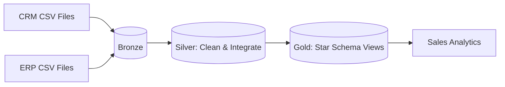

# 🏬 Retail Sales Data Warehouse | Guided SQL Learning Project

  

> **Learning disclosure:** This is a guided practice implementation inspired by [Data With Baraa's SQL Data Warehouse tutorial](https://github.com/DataWithBaraa/sql-data-warehouse-project). It uses the same *type of retail CRM/ERP scenario and Medallion stages*, but includes **small synthetic practice data and independently authored SQL**. It is **not an exact copy of Baraa's full repository or datasets**. For exact course assets, obtain the [original download](https://github.com/DataWithBaraa/sql-data-warehouse-project/archive/refs/heads/main.zip).

## 🎯 What am I building?

Combine six CRM/ERP source datasets into a SQL Server warehouse with raw ingestion, cleaning, integration and reporting-friendly dimensions and sales facts. The goal is to practice **how** each layer works, not just copy SQL.

## 🗺️ Architecture

## 📁 Repository

- `00_setup/` — installation and execution order
- `01_datasets/` — six **small synthetic** CRM/ERP practice CSV datasets
- `02_docs/` — requirements, architecture, mapping, data dictionary, learning notes, diagrams and Notion-import CSV
- `03_scripts/` — database, Bronze, Silver, Gold and analytical SQL
- `04_tests/` — quality and reconciliation SQL checks
- `LICENSE-AND-ATTRIBUTION.md` — provenance information

## 🚀 Getting started

1. Install SQL Server 2022+ (or a supported recent version) and SSMS/Azure Data Studio.
2. Run `03_scripts/init_database.sql` (**this resets the dedicated learning database**).
3. Update the six `BULK INSERT` absolute file paths in `03_scripts/bronze/proc_load_bronze.sql` to your local extracted folder. On Windows use e.g. `C:\retail-dwh\01_datasets\source_crm\cust_info.csv`.
4. Execute SQL scripts in the order documented in [`00_setup/README.md`](00_setup/README.md).
5. Run `EXEC bronze.load_bronze;` then `EXEC silver.load_silver;`.
6. Run `04_tests/quality_checks.sql` and `04_tests/reconciliation.sql`.
7. Query `gold.fact_sales`, `gold.dim_customers` and `gold.dim_products`.

**Note:** SQL Server's service account must have permission to read CSV paths. The sample data is intentionally small, so displayed analytics are illustrations, not a real business benchmark.

## ✨ Key transformations

| Layer | What happens | Why it matters |
|---|---|---|
| Bronze | Import raw files | Preserve source values for investigation |
| Silver | Remove duplicates, trim values, normalize codes, filter bad dates | Prevent source inconsistencies from polluting reports |
| Gold | Join CRM and ERP fields into customer/product dimensions, expose sales fact | Make analytical queries simpler |

## 🧪 Quality and validation

Tests flag duplicate business keys, orphan fact references, invalid dates and missing categories. Checks print failures or raise errors; **SQL Server runtime execution has not been verified in this environment**.

## 📚 My learning notes

Read [`02_docs/learning-notes`](02_docs/learning-notes) to follow the phases and understand the reason for each SQL step. A CSV task plan is supplied in `02_docs/notion-import/tasks.csv` for manual import to Notion. The `.drawio` file can be edited in [diagrams.net](https://app.diagrams.net/).

## 📝 Important scope decisions

- This practice uses a **full refresh**, not incremental CDC.
- Gold is based on the latest available source state; **SCD Type 2 is not implemented**.
- No production monitoring, error quarantine, or automated orchestration is claimed.

## 🙏 Attribution

Tutorial inspiration and original full data/code: [Data With Baraa](https://github.com/DataWithBaraa/sql-data-warehouse-project) (MIT licensed). This project does not reproduce the full original repository. Please credit the tutorial when sharing your training work.
